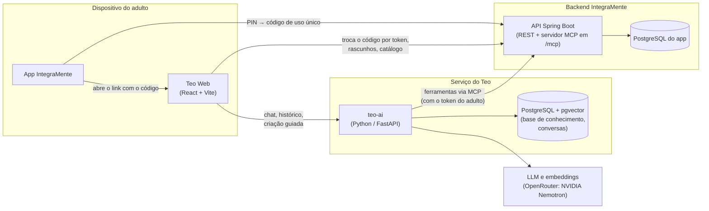
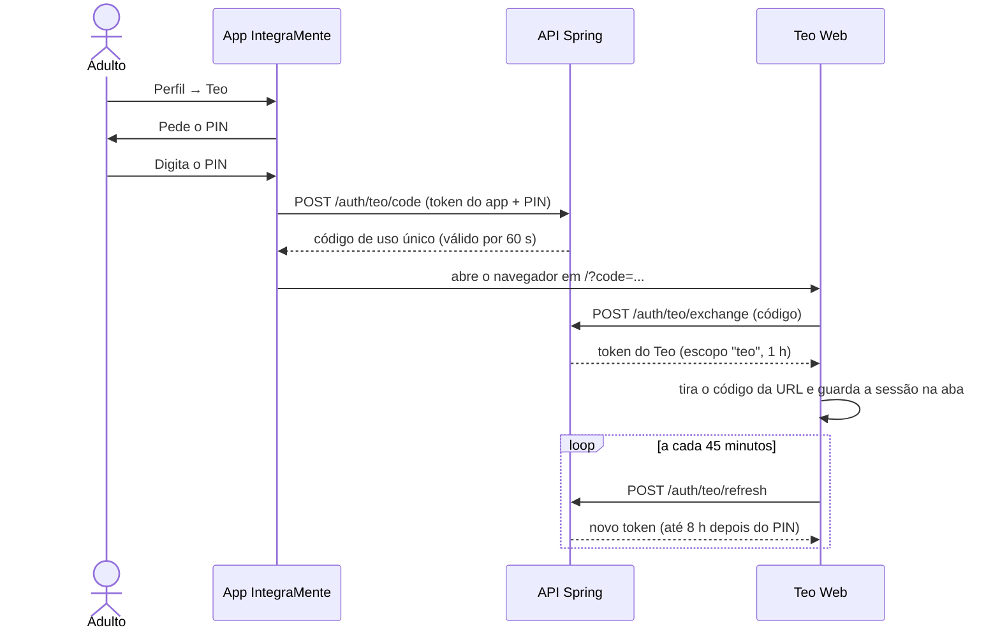
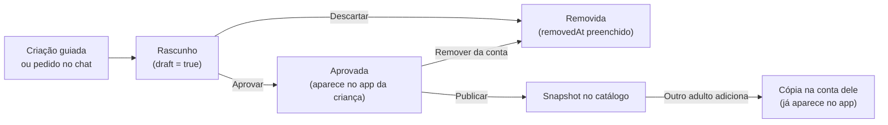

# Novidades do IntegraMente: PIN e Teo

> Documento de apoio para atualizar a documentação do TCC. Cobre **apenas o que é novo**: as mudanças no **PIN** e o assistente **Teo**. O restante do IntegraMente (app, backend, matérias e atividades) já está documentado e não é repetido aqui.
>
> Os fatos técnicos (números, regras, rotas e tabelas) foram conferidos no código.

---

# Parte 1 — PIN

## 1.1 O que mudou

Antes, o PIN que protege a área dos responsáveis podia ser testado sem limite. Agora existe um **limite de tentativas**:

- Após **5 tentativas erradas**, o PIN fica **bloqueado por 2 minutos**.
- Durante o bloqueio, o backend responde **HTTP 429 (Too Many Requests)** com o cabeçalho **`Retry-After`**, que informa quantos segundos faltam.
- Um acerto zera o contador de erros.
- O bloqueio vale para os dois usos do PIN: a área dos responsáveis no app (`POST /auth/pin`) e a abertura do Teo (`POST /auth/teo/code`, ver Parte 2).

## 1.2 Backend

- O estado do bloqueio fica salvo no usuário: novos campos `pin_failed_attempts` e `pin_locked_until` na tabela `users`.
- A lógica está no `AuthController`:
  - `checkPin` confere o PIN e conta os erros; na 5ª tentativa errada, define `pinLockedUntil` = agora + 2 minutos.
  - `isPinLocked` verifica se o bloqueio ainda vale.
  - `pinLockedResponse` monta a resposta 429 com o `Retry-After`.

## 1.3 App

- **Modal do PIN (`PinModal`)**: ao receber o 429, mostra a mensagem "Muitas tentativas. Tente de novo em X minutos." e **trava o teclado**. O campo fica não editável, perde o foco e não reabre o teclado ao mostrar o modal.
- **Hook `usePin`**: guarda até quando o PIN está bloqueado e destrava sozinho quando o tempo acaba. Usa o valor do `Retry-After` ou, se o cabeçalho não vier, 2 minutos.
- O `usePin` passou a aceitar uma **função de verificação** como parâmetro. Assim, o mesmo modal serve para verificar o PIN da área dos responsáveis e para abrir o Teo (hook `useTeo`).

---

# Parte 2 — Teo

## 2.1 O que é

O **Teo** é um assistente com inteligência artificial voltado **aos adultos** que acompanham a criança: pais, responsáveis e profissionais. Ele permite:

1. **Conversar sobre autismo**, com respostas baseadas em uma base de conhecimento curada (RAG) e **com citação das fontes**.
2. **Criar atividades** para o app da criança, de forma guiada ou pelo chat. Toda atividade nasce como **rascunho** e só chega à criança depois que o adulto **aprova**.
3. **Compartilhar e reaproveitar atividades** em um **catálogo** gratuito e opcional: um adulto publica e outros copiam para a própria conta.

O Teo é uma aplicação **web**, aberta a partir do app depois que o adulto digita o **PIN**. Ele usa as **mesmas contas e o mesmo backend** do IntegraMente e tem um **serviço próprio em Python** para a IA.

### Por que web, e não dentro do app?

- O app é usado pela criança. Uma tela web separada, aberta só após o PIN, isola a experiência do adulto.
- Evita manter versões nativas do assistente e permite usar o Teo também no computador.
- O app só precisa abrir um link; o Teo evolui sem publicar nova versão do app.

## 2.2 Funcionalidades

### Conversa (chat)

- Responde em português, com frases curtas e tom acolhedor.
- Busca trechos na **base de conhecimento** (documentos curados sobre autismo, direitos e educação inclusiva) e **cita as fontes** numeradas, com título e link.
- Se a base não trouxer nada útil, diz que não tem a informação e sugere procurar um profissional.
- **Histórico de conversas**:
  - as conversas ficam salvas por usuário;
  - aparecem agrupadas em "Hoje", "Esta semana" e "Anteriores", com busca por título;
  - dá para reabrir uma conversa ou começar uma nova.
- Pelo chat também dá para pedir uma atividade ou ideias do catálogo.

**Regras de comportamento** (prompt de sistema):

- Não faz diagnóstico, não indica remédio nem dose e não substitui terapia. Se perguntarem se a criança é autista, acolhe e orienta procurar o pediatra, que pode encaminhar para neuropediatra, psiquiatra infantil ou psicólogo.
- Não pede nem repete dados que identifiquem a criança (nome completo, escola, endereço).
- Em caso de crise ou risco, indica o **CVV (188, 24 horas)** ou o **SAMU (192)**.
- Não mostra nomes técnicos internos; fala em "atividade", "matéria" e "letras que ficam vazias".
- Nunca diz que uma atividade já está no app da criança antes da aprovação.

### Criar atividade (criação guiada)

Tela própria, separada do chat, em duas etapas:

1. **Escolha o tipo.** Hoje está disponível **"Complete a palavra"**. "Monte o mapa" e "Complete o corpo" aparecem como "Em breve".
2. **Personalize e gere.**
   - **Por tema**: o adulto escreve um tema (ex.: "animais da fazenda") e escolhe a **quantidade de palavras** (1 a 10). A IA escolhe palavras ligadas ao tema e um emoji para cada uma.
   - **Minhas palavras**: o adulto digita as palavras (até 10, de 2 a 8 letras) e, se quiser, um nome para a atividade. A IA só escolhe os emojis.
   - **Letras escondidas**: "O Teo escolhe", 1, 2 ou 3 por palavra.
   - Um **resumo em linguagem simples** mostra o que será criado.
   - Depois de gerar, aparece a **prévia** com **Aprovar**, **Gerar de novo** (descarta o rascunho anterior) ou **Descartar**.

### Minhas atividades

- Atividades da conta criadas com o Teo ou adicionadas do catálogo, separadas em **"Esperando aprovação"** e **"No app"**.
- Ações: prévia, aprovar, descartar, **publicar no catálogo** ou tirar dele, e **remover da conta**.

### Catálogo

- Lista atividades publicadas por outros adultos, com **busca**, **filtro por matéria** e destaque para a **"Mais copiada"**.
- Mostra título, matéria, autor (só o primeiro nome), número de cópias e prévia.
- **Adicionar** copia a atividade para a conta (com confirmação). A cópia **vai direto para o app da criança**, porque já foi revisada por quem publicou.

**Regras do catálogo:**

- Só pode publicar atividade **aprovada**, **criada pela própria pessoa** (não uma cópia) e **ainda não publicada**.
- Antes de publicar, o Teo avisa para conferir se não há nome da criança ou outro dado pessoal.
- O catálogo guarda uma **cópia congelada** (snapshot): mudanças no original não alteram o publicado.
- Não dá para copiar a própria atividade nem copiar a mesma duas vezes.
- **Remover** a original da conta também a **tira do catálogo**; quem já copiou mantém a sua cópia.

## 2.3 Arquitetura

| Componente | Tecnologia | Responsabilidade |
|---|---|---|
| **App IntegraMente** (alterado) | React Native + Expo | Novo item "Teo" no Perfil, protegido por PIN, que abre o Teo Web. |
| **API IntegraMente** (alterada) | Spring Boot, Spring Security, JWT, **Spring AI 2.0.1** | Acesso ao Teo, rascunhos, catálogo e um **servidor MCP** com as ferramentas que a IA pode usar. |
| **teo-ai** (novo) | Python, FastAPI, SDK oficial do MCP, SDK OpenAI (apontado para o OpenRouter), psycopg, pgvector | Agente de IA: conversa, RAG, histórico e criação guiada. Não acessa o banco do app: tudo passa pela API via MCP. |
| **Banco do Teo** (novo) | PostgreSQL 17 + **pgvector** | Documentos da base de conhecimento, trechos com embeddings, conversas e mensagens (schema `teo`). |
| **Teo Web** (novo) | React 19, TypeScript, Vite | Interface do adulto: chat com histórico, criação guiada, minhas atividades e catálogo. |
| **Modelos de IA** | OpenRouter (API compatível com OpenAI) | Chat: `nvidia/nemotron-3-super-120b-a12b:free`. Embeddings: `nvidia/nemotron-3-embed-1b:free` (2048 dimensões). |

### Por que MCP (Model Context Protocol)?

O **MCP** é um protocolo aberto para expor "ferramentas" a modelos de linguagem. O backend Spring é o **servidor MCP** (transporte HTTP *streamable*, em `/mcp`) e o teo-ai é o **cliente MCP**.

- **A IA nunca acessa o banco diretamente**: só faz o que as ferramentas permitem, com as mesmas validações da API.
- **As ações são feitas em nome do adulto**: o teo-ai repassa o token do adulto e o Spring identifica o usuário por ele.
- **Separação de responsabilidades**: o Python cuida da IA; o Java continua dono dos dados e das regras.

| Ferramenta MCP | O que faz |
|---|---|
| `list_subjects` | Lista as matérias. |
| `search_catalog` | Busca atividades no catálogo (texto opcional). |
| `list_my_drafts` | Lista as atividades da conta. |
| `create_letters_draft` | Cria um rascunho "Complete a palavra" (título, matéria e palavras com letras vazias e emoji). |

O agente também tem uma ferramenta local, `search_knowledge`, que consulta a base de conhecimento no próprio teo-ai.

### Como o agente funciona

1. O adulto envia uma mensagem; o teo-ai carrega as últimas **12 mensagens** da conversa.
2. O teo-ai abre uma sessão MCP com o backend (com o token do adulto) e lista as ferramentas.
3. O modelo responde direto ou chama ferramentas, em no máximo **6 passos**.
4. A resposta volta com o texto, as **fontes** e os **rascunhos criados**, que aparecem como cartões de prévia no chat.
5. Pergunta e resposta são salvas no histórico.

### RAG (base de conhecimento)

- Os documentos ficam na pasta `knowledge/` do teo-ai, descritos em `fontes.json` (arquivo, título, link). Serão fornecidos e revisados por uma profissional da área.
- **Ingestão** (script próprio):
  - divide o texto em trechos de **600 palavras com 80 de sobreposição**;
  - gera os embeddings e grava no banco;
  - ignora arquivos sem mudança (hash SHA-256) e desativa os removidos da lista.
- **Busca**:
  - a pergunta vira um vetor;
  - o banco devolve os **5 trechos mais parecidos** (cosseno);
  - trechos com pontuação abaixo de **0,35** são descartados.
- Os vetores usam `halfvec(2048)` com índice **HNSW**. O índice do pgvector aceita até 2000 dimensões no tipo `vector` comum, e o modelo gera 2048; o `halfvec` (meia precisão) resolve isso.

### Como a atividade "Complete a palavra" é montada

A criação guiada tem rota própria no teo-ai (`POST /activities/letters`), sem passar pelo agente de conversa:

1. **Palavras**:
   - **por tema**, a IA devolve um JSON com título e palavras com emoji, com até 2 tentativas;
   - **com palavras digitadas**, a IA só escolhe os emojis (se falhar, usa ⭐).
2. **Validação**: maiúsculas, só letras (com acentos e Ç), de **2 a 8 letras**, sem repetição, até **10 palavras**.
3. **Letras escondidas** (quando "o Teo escolhe"):
   - quantas: 1 para palavras de até 3 letras, 2 para até 5, 3 para as maiores;
   - quais: prioriza **vogais**, não repete letra e sempre deixa ao menos uma visível.
4. **Rascunho**: o teo-ai chama a ferramenta MCP `create_letters_draft`.
   - No Spring, o `LettersBuilder` monta cada questão: dica em emoji, posições das letras e alternativas com as letras corretas e **2 distratoras**.
   - O `LettersValidator` confere o conteúdo antes de salvar.
5. A atividade é criada na matéria **Linguagens**, com subtítulo "Criada com o Teo", como **rascunho**.

## 2.4 Fluxos

### Abrir o Teo pelo app

- **Não existe tela de login no Teo**: o acesso vem sempre do app, depois do PIN.
- O item "Teo" do Perfil só aparece quando a configuração `EXPO_PUBLIC_TEO_ENABLED` está ativa.
- O **código** da URL é aleatório (32 bytes), **vale 60 segundos** e **só pode ser usado uma vez**. Depois da troca, ele é apagado da barra de endereço.
- O **token do Teo** é diferente do token do app:
  - tem o escopo `teo`;
  - guarda o momento em que o PIN foi digitado;
  - vale 1 hora e o Teo Web o renova a cada 45 minutos;
  - **a renovação é negada 8 horas depois do PIN**.
- A sessão fica no `sessionStorage`: fechar a aba encerra o acesso.

### Ciclo de uma atividade

### O que muda no que a criança vê

O app passou a listar apenas tópicos **jogáveis**: **oficiais** (sem dono) ou da **própria conta**, que **não sejam rascunho**, **não sejam o snapshot do catálogo** e **não tenham sido removidos**. Rascunhos e atividades de outras contas nunca aparecem para a criança.

## 2.5 Segurança e privacidade

- As rotas do Teo (renovação, `/mcp`, `/drafts` e `/catalog`) exigem a autoridade `SCOPE_teo` no Spring Security. O token comum do app não tem essa autoridade e não acessa essas rotas.
- O token do Teo carrega **apenas** a autoridade `SCOPE_teo`, e não os papéis normais do usuário. Ele ainda é aceito nas demais rotas do app que só exigem estar autenticado; restringi-lo às rotas do Teo é uma melhoria planejada.
- O teo-ai valida o token sozinho (chave HS256, emissor `auth-integramente`, escopo `teo`) antes de qualquer ação.
- O **CORS** do backend e do teo-ai só aceita as origens configuradas do Teo Web.
- **Nada chega à criança sem aprovação** de um adulto (exceto cópias do catálogo, já revisadas por quem publicou).
- **Validação no backend**: o conteúdo é conferido pelo `LettersValidator` mesmo que a IA erre.
- **Aviso de dados pessoais** antes de publicar e **só o primeiro nome** do autor no catálogo.
- **Remoção lógica** (`removedAt`): a atividade sai da conta e do app sem apagar o histórico de tentativas.

## 2.6 Mudanças no banco de dados

**Tabela `topics`** (banco do app) — campos novos:

| Campo | Significado |
|---|---|
| `owner_id` | Dono da atividade. Vazio = **oficial**; preenchido = atividade de uma conta. |
| `draft` | `true` enquanto é rascunho. |
| `catalog` | `true` quando o tópico é o **snapshot publicado** no catálogo. |
| `forked_from_id` | De qual tópico ele veio: no snapshot aponta para o original; na cópia de outro adulto, para o snapshot. Também identifica cópias, que não podem ser republicadas. |
| `removed_at` | Data da remoção lógica. |

Copiar uma atividade é uma **cópia profunda**: tópico → questões → alternativas.

**Banco do Teo** (schema `teo`, novo):

| Tabela | Conteúdo |
|---|---|
| `documents` | Documentos da base de conhecimento (arquivo, título, link, status, hash). |
| `chunks` | Trechos com embedding (`halfvec(2048)`, índice HNSW) e página. |
| `conversations` | Conversas por usuário, com **título** gerado a partir da primeira mensagem (até 60 caracteres). |
| `messages` | Mensagens de cada conversa. |

## 2.7 Rotas novas

**API Spring:**

| Rota | Acesso | Descrição |
|---|---|---|
| `POST /auth/teo/code` | token do app + PIN | Gera o código de uso único. |
| `POST /auth/teo/exchange` | público (código) | Troca o código pelo token do Teo. |
| `POST /auth/teo/refresh` | token do Teo | Renova o token (até 8 h após o PIN). |
| `POST /drafts/letters` | token do Teo | Cria rascunho "Complete a palavra". |
| `GET /drafts` | token do Teo | Lista as atividades da conta. |
| `GET /drafts/{id}/activity` | token do Teo | Conteúdo para a prévia. |
| `POST /drafts/{id}/approve` · `/remove` · `/publish` · `/unpublish` | token do Teo | Aprovar, remover, publicar e tirar do catálogo. |
| `GET /catalog?subjectId=&q=` | token do Teo | Lista e busca o catálogo. |
| `GET /catalog/{id}/activity` | token do Teo | Prévia de uma atividade do catálogo. |
| `POST /catalog/{id}/copy` | token do Teo | Adiciona a atividade à conta. |
| `/mcp` | token do Teo | Servidor MCP com as ferramentas da IA. |

**teo-ai:**

| Rota | Descrição |
|---|---|
| `GET /health` | Verifica se o serviço está no ar. |
| `POST /chat` | Envia mensagem ao Teo (`message` e, opcionalmente, `conversationId`). |
| `GET /conversations` | Lista as conversas (mais recentes primeiro, até 50). |
| `GET /conversations/{id}/messages` | Mensagens de uma conversa. |
| `POST /activities/letters` | Criação guiada: `theme` ou `words`, `count` (1–10) e `hidden` (1–3 ou automático). |

## 2.8 Interface (Teo Web)

- **Tema escuro único**, baseado em protótipo feito no Claude Design, com a fonte **Lexend** e gradientes em azul e roxo.
- **Mascote do Teo** (pinguim) em várias poses, conforme o contexto:
  - feliz na tela inicial e voando na abertura;
  - pensando enquanto responde ou gera;
  - joinha e acenando na criação de atividades;
  - de braços cruzados nos estados vazios e com medalha no destaque do catálogo.
- **Barra lateral recolhível** com busca de conversas, histórico, "Nova conversa", "Criar atividade", "Minhas atividades", "Catálogo" e o cartão do usuário.
- **Responsiva**: no celular, a barra lateral vira uma gaveta.
- Tela de abertura animada, avisos rápidos (toasts) e respeito à preferência por **menos movimento**.

## 2.9 Decisões técnicas

| Decisão | Motivo |
|---|---|
| Teo como **web**, aberto pelo app | Isola o adulto da criança, evita versões nativas e evolui sem publicar o app. |
| **Mesmo backend e mesmas contas** | Sem novo cadastro; as atividades vão direto para a conta usada no app. |
| **Serviço de IA em Python** | Ecossistema de IA (MCP, SDKs, pgvector) mais maduro; o Java segue dono das regras. |
| **MCP** entre IA e backend | A IA só age por ferramentas validadas e em nome do usuário. |
| **PIN + código de uso único**, sem login no Teo | Reaproveita a barreira do PIN e evita passar senha ou token do app pela URL. |
| **Token com escopo próprio e limite de 8 h** | Limita o que o token faz e por quanto tempo vale sem novo PIN. |
| **Rascunho + aprovação** | Um adulto sempre revisa o que a IA criou antes de chegar à criança. |
| **Catálogo como snapshot e cópia profunda** | O publicado não muda depois; cada família tem a própria cópia. |
| **Modelos gratuitos via OpenRouter** | Custo zero; API compatível com a da OpenAI, então dá para trocar de modelo só na configuração. |
| **Tipos de atividade fixos** | A IA varia o conteúdo, mas não inventa tipos novos de jogo; assim, tudo o que ela cria funciona no app. |

## 2.10 Estado atual e próximos passos

**Pronto e testado (ambiente local):**

- Acesso pelo Perfil com PIN e código de uso único.
- Agente com RAG, fontes e regras de segurança.
- Servidor MCP.
- Rascunhos "Complete a palavra" e aprovação.
- Catálogo.
- Histórico de conversas e criação guiada.
- Novo visual do Teo Web.

**Próximos passos:**

- **Deploy**:
  - teo-ai e Teo Web no Render;
  - `vector` e schema `teo` no Supabase;
  - variáveis de produção e nova versão do app.
- **Base de conhecimento**: receber e revisar os documentos com a profissional parceira e calibrar o limite de relevância (0,35). Hoje a base local está vazia.
- **Novos tipos de atividade**:
  - "Soma com bolinhas" e "Agrupar" são bons candidatos para a IA;
  - "Monte o mapa" e "Complete o corpo" dependem de desenhos (SVG) já cadastrados;
  - "Subtração" ainda precisa ser ligada no app.
- **Segurança em produção**: chave JWT mais longa, troca da chave do provedor de IA e restrição do token do Teo às rotas do Teo.

## 2.11 Glossário

- **RAG**: a IA busca trechos relevantes numa base de documentos antes de responder, para se basear neles e citar as fontes.
- **Embedding**: texto representado como vetor de números; textos de sentido parecido ficam próximos.
- **pgvector / HNSW**: extensão do PostgreSQL para vetores e índice para buscar os mais parecidos rapidamente.
- **MCP (Model Context Protocol)**: protocolo aberto para expor ferramentas a modelos de linguagem.
- **Agente**: modelo de linguagem que decide quando usar ferramentas para cumprir um pedido.
- **Escopo do token**: marca no token que define o que ele pode acessar.
- **Rascunho (draft)**: atividade criada, ainda não aprovada; não aparece para a criança.
- **Snapshot**: cópia congelada de uma atividade no momento da publicação.
